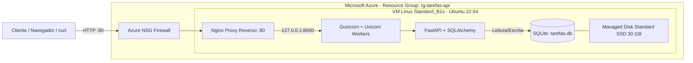

# API de Tarefas — FastAPI + SQLite (Cloud VM Deploy)

API REST básica desenvolvida em **Python 3.12 (FastAPI)** com banco de dados relacional **SQLite** e preparada para hospedagem fim a fim em máquina virtual Linux (**Ubuntu Server 22.04 LTS**) na nuvem (**Microsoft Azure**).

## 1. Arquitetura da Solução



## 2. Elementos de Nuvem Utilizados

| Elemento | Especificação Planejada | Função na Arquitetura |
| :--- | :--- | :--- |
| **Provedor & Região** | Microsoft Azure (`brazilsouth`) | Hospedagem em nuvem com baixa latência no Brasil. |
| **Máquina Virtual (SKU)** | `Standard D2as v4` (1 vCPU, 1 GiB RAM) | Instância burstable econômica ideal para APIs leves. |
| **Sistema Operacional** | Ubuntu Server 22.04 LTS (x64) | Base do servidor de aplicação e proxy reverso. |
| **Armazenamento** | Azure Managed Disk — Standard SSD (30 GB, LRS) | Persistência do sistema e do banco `/var/lib/tarefas-api/tarefas.db`. |
| **Rede / Segurança** | VNet + IP Público Estático + NSG (Portas 22 e 80) | Controle de tráfego HTTP e administração via SSH. |
| **Linguagem & Stack** | Python 3.12 + FastAPI + SQLAlchemy + SQLite | Aplicação web assíncrona com validação Pydantic e ORM. |

## 3. Endpoints Disponíveis

- `GET /health` — Verificação de disponibilidade da API (`{"status": "ok"}`).
- `POST /categorias` — Cria uma categoria (`201 Created`, `409 Conflict` se duplicada).
- `GET /categorias` — Lista categorias em ordem alfabética.
- `POST /tarefas` — Cria uma nova tarefa (`201 Created`).
- `GET /tarefas` — Lista tarefas (filtros opcionais: `?concluida=true` e `?categoria_id=1`).
- `GET /tarefas/{id}` — Obtém os detalhes de uma tarefa específica.
- `PATCH /tarefas/{id}` — Atualiza parcialmente uma tarefa (ex.: marcar como concluída).
- `DELETE /tarefas/{id}` — Remove uma tarefa (`204 No Content`).
- `GET /docs` — Documentação interativa **Swagger UI**.

## 4. Como Executar Localmente

```bash
python3 -m venv venv
source venv/bin/activate
pip install -r requirements.txt

# Rodar os testes automatizados
pytest -v

# Iniciar o servidor localmente
uvicorn app.main:app --reload
```
